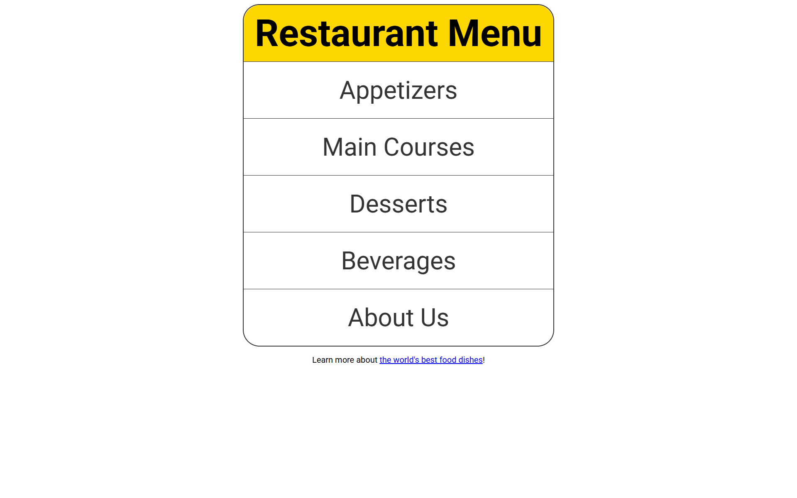

# 🍽️ Restaurant Menu Component


A multi-page restaurant menu interface built to practice foundational CSS concepts, including the CSS Box Model, border radius, hover pseudo-classes, page navigation, and component styling.

---



---

## ✨ Features

- **Multi-Page Navigation:** Fluid tab-like navigation linking menu categories (`one.html`, `two.html`, `three.html`).
- **CSS Box Model Mastery:** Precise control of margin, padding, border, and content boundaries.
- **Interactive States:** Dynamic `:hover` pseudo-class visual transitions on menu items.
- **Rounded Card Styling:** Reusable menu card components using `border-radius` and modern contrast.

---

## 🛠️ Tech Stack

- **HTML5:** Page structure and inter-page navigation links.
- **CSS3:** Box model, border styling, color schemes, typography, and hover states.

---

## 📁 Project Structure

```
Restaurant_Menu/
├── website-preview/    # Screenshot previews
│   ├── mainCss.png
│   └── onHover.png
├── index.html          # Landing page
├── one.html            # Appetizers / Menu page 1
├── two.html            # Main Courses / Menu page 2
├── three.html          # Desserts & Drinks / Menu page 3
├── readme.md
└── style.css           # Core stylesheet
```

---

## ▶️ Getting Started

1. Navigate to this directory:
   ```bash
   cd css/projects/Restaurant_Menu
   ```
2. Open `index.html` in any web browser.

---

<p align="center">
  📂 <strong><a href="../../readme.md">← Back to CSS Lessons</a></strong> | <strong><a href="../../../README.md">← Repository Home</a></strong>
</p>
