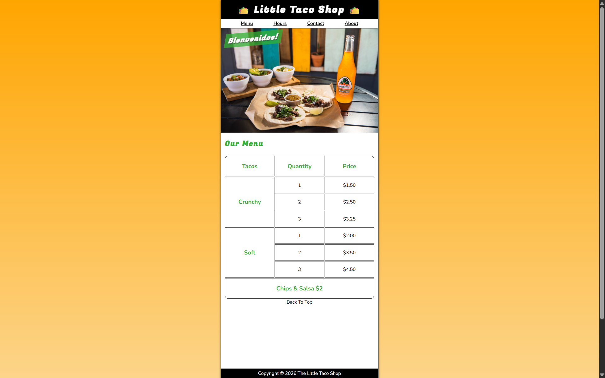
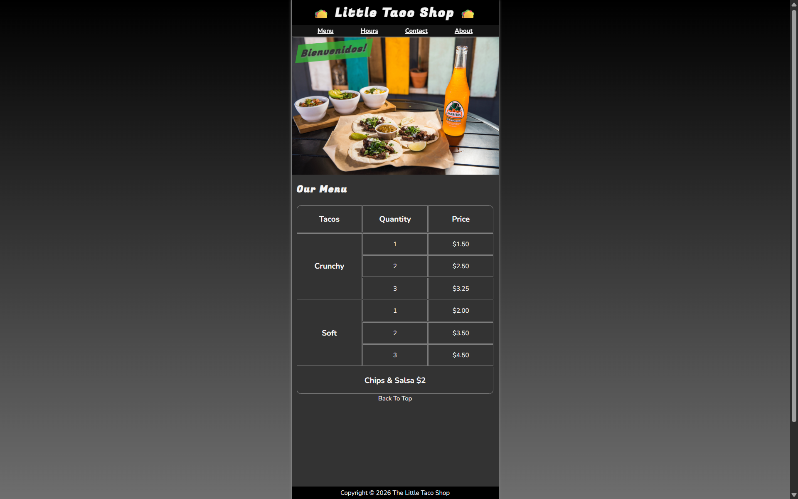

# 🌮 The Little Taco Shop (Responsive + Theme Toggle)


An advanced, responsive redesign of The Little Taco Shop featuring full CSS custom properties, fluid layouts, responsive media queries, and an interactive dark/light mode toggle.

---

| Light Mode | Dark Mode |
|:---:|:---:|
|  |  |

---

## ✨ Features

- **🌓 Dark & Light Theme Switcher:** Dynamic theme toggle implemented via CSS custom properties and lightweight JavaScript (`js/main.js`).
- **📱 Responsive Media Queries:** Breakpoints tuned for seamless desktop, tablet, and mobile viewing.
- **🎨 CSS Custom Properties:** Centralized color schemes and spacing tokens for effortless theme switching.
- **📑 Multi-Page Architecture:** Fully styled Home, About, Store Hours, and Contact pages.

---

## 🛠️ Tech Stack

- **HTML5:** Semantic document foundations and accessible content flow.
- **CSS3:** Custom properties (variables), media queries, Flexbox, and transition animations.
- **JavaScript:** Theme toggle state management in `js/main.js`.

---

## 📁 Project Structure

```
Taco_Shop/
├── css/
│   └── style.css       # Main responsive stylesheet with CSS variables
├── img/                # Photography assets
├── js/
│   └── main.js         # Theme toggle switcher logic
├── website-preview/
│   ├── DarkMode/       # Previews in dark theme
│   └── LightMode/      # Previews in light theme
├── about.html          # Brand story and history
├── contact.html        # Interactive contact form
├── index.html          # Store landing page
├── readme.md
└── storeHours.html     # Operating hours and location
```

---

## ▶️ Getting Started

1. Navigate to this directory:
   ```bash
   cd css/projects/Taco_Shop
   ```
2. Open `index.html` in your web browser. Try clicking the theme switcher button to toggle between light and dark modes!

---

<p align="center">
  📂 <strong><a href="../../readme.md">← Back to CSS Lessons</a></strong> | <strong><a href="../../../README.md">← Repository Home</a></strong>
</p>
