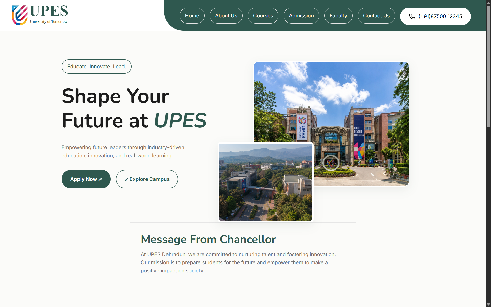

# 🎓 UPES College Website Portal (CSS3 Styled)


An enhanced, fully styled multi-page university website demonstrating modern CSS3 layout techniques, card grids, responsive navigation, custom form styling, and interactive UI micro-interactions.

---



---

## ✨ Features & Enhancements

- **Modern Visual Design:** Clean, consistent typography, custom card components, and branded color palette.
- **Responsive Flexbox & Grid:** Structured layouts adapting gracefully to different screen viewports.
- **Styled Form Components:** Enhanced input focus states, fieldset grouping, and customized submission controls.
- **Multi-Page Experience:** Complete navigation across Home, Courses, Admission, Faculty, and Contact pages.

---

## 🛠️ Tech Stack

- **HTML5:** Semantic document foundations and structured data tables.
- **CSS3:** Custom properties, Flexbox, Grid, transitions, and responsive styling.
- **JavaScript:** Client-side form interactions and dynamic helpers.

---

## 📁 Project Structure

```
college-website/
├── assets/             # Brand logos, icons, and media assets
├── css/                # Custom stylesheets (layout, components, typography)
├── js/                 # Client scripting helpers
├── website-preview/    # Visual previews of each page
│   ├── admission.png
│   ├── contactus.png
│   ├── courses.png
│   ├── faculty.png
│   ├── Homepage1.png
│   ├── HomePage2.png
│   └── submit.png
├── admission.html      # Styled student admission portal
├── contact.html        # Styled campus location & contact page
├── courses.html        # Styled academic course matrix
├── faculty.html        # Styled faculty directory
├── index.html          # Main portal homepage
├── readme.md
└── submit.html         # Form completion acknowledgement
```

---

## ▶️ Getting Started

1. Navigate to this directory:
   ```bash
   cd css/projects/college-website
   ```
2. Open `index.html` in your web browser.

---

<p align="center">
  📂 <strong><a href="../../readme.md">← Back to CSS Lessons</a></strong> | <strong><a href="../../../README.md">← Repository Home</a></strong>
</p>
