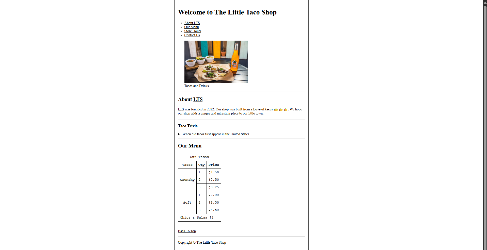

# 🌮 The Little Taco Shop (HTML5)


A semantic, multi-page business website for a taco shop created to practice accessible HTML5 document outlines, data tables, and interactive details elements.

---



---

## ✨ Features

- **Semantic Page Outlines:** Built with `<header>`, `<nav>`, `<main>`, `<section>`, `<figure>`, `<figcaption>`, and `<footer>`.
- **Menu Pricing Tables:** Structured `<table>` display for taco varieties, fillings, and prices.
- **Interactive Details:** Native `<details>` and `<summary>` tags for expanding FAQ and trivia content.
- **Contact Inquiries:** Accessible inquiry form with labeled input fields and submit actions.

---

## 🛠️ Tech Stack

- **HTML5:** Semantic document tags, tables, forms, and intra-site navigation.
- **CSS:** Minimal reset and layout styling in `main.css`.

---

## 📁 Project Structure

```
Taco_Shop/
├── img/                # Taco photography and icons
├── website-preview/    # Screenshots of pages
│   ├── contactUs.png
│   ├── homePage.png
│   └── storeHours.png
├── contact.html        # Customer contact & feedback form
├── index.html          # Store landing page, about story, & menu table
├── main.css            # Base stylesheet
├── readme.md
└── storeHours.html     # Operating hours and schedule
```

---

## ▶️ Getting Started

1. Navigate to this directory:
   ```bash
   cd html/projects/Taco_Shop
   ```
2. Open `index.html` directly in any web browser.

---

<p align="center">
  📂 <strong><a href="../../readme.md">← Back to HTML Lessons</a></strong> | <strong><a href="../../../README.md">← Repository Home</a></strong>
</p>
