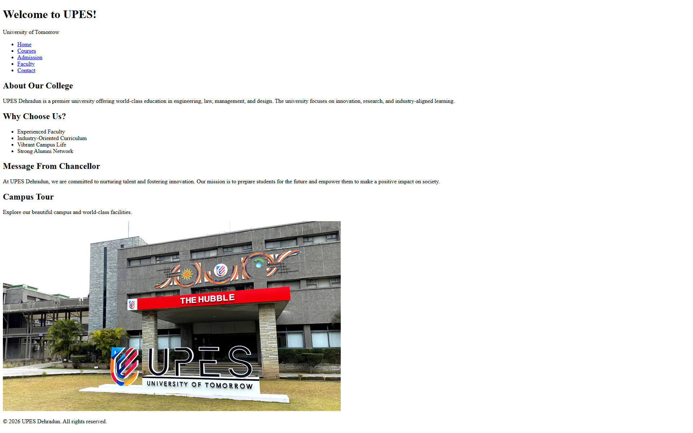

# 🎓 UPES College Website Portal (HTML5)


A multi-page university website built with pure semantic HTML5 to demonstrate structured document hierarchy, accessible navigation, tabular data presentation, and complex form handling.

---



---

## ✨ Features

- **Multi-Page Navigation:** Decoupled architecture across 5 pages: Home, Courses, Admission, Faculty, and Contact.
- **Accessible Form Controls:** Dedicated admission form with `<fieldset>`, `<legend>`, required inputs, radio groups, select menus, and textarea fields.
- **Tabular Data Presentation:** Well-formed `<table>` elements with `<thead>`, `<tbody>`, `<tr>`, and `<td>` for course seat matrices and faculty directories.
- **Semantic Structure:** Comprehensive use of `<header>`, `<nav>`, `<main>`, `<section>`, `<article>`, and `<footer>`.

---

## 🛠️ Tech Stack

- **HTML5:** Semantic elements, form validation attributes, table markup, and hyperlinks.

---

## 📁 Project Structure

```
college-website/
├── img/                # Campus and faculty imagery
├── website-preview/    # Page preview screenshots
│   ├── AdmissionPage.png
│   ├── ContactPage.png
│   ├── CoursePage.png
│   ├── FacultyPage.png
│   ├── HomePage.png
│   └── SubmitPage.png
├── admission.html      # Admission registration form
├── contact.html        # Campus contact info and location details
├── courses.html        # Academic programs and seat matrix tables
├── faculty.html        # Department faculty roster table
├── index.html          # Main university portal home
├── readme.md
└── submit.html         # Form submission confirmation page
```

---

## ▶️ Getting Started

1. Clone or download the repository.
2. Navigate to this directory:
   ```bash
   cd html/projects/college-website
   ```
3. Open `index.html` directly in any web browser — no dependencies or build tools needed.

---

<p align="center">
  📂 <strong><a href="../../readme.md">← Back to HTML Lessons</a></strong> | <strong><a href="../../../README.md">← Repository Home</a></strong>
</p>
